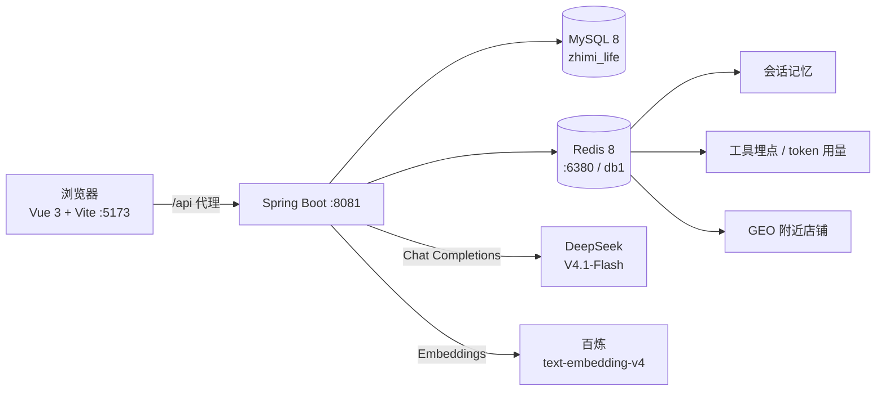
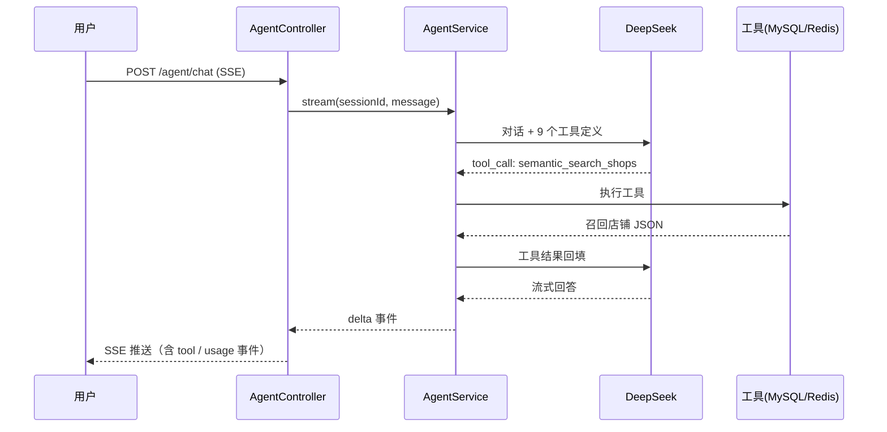

# 智觅生活 · AI 找店助手

> 说一句想找什么样的店，AI 自己决定查什么、怎么查，返回真实数据而不是编造。

## 项目简介

智觅生活是一个本地生活类的 AI 找店助手。用户用自然语言描述需求——

> "帮我找个适合约会、安静一点的地方，人均别太贵"

模型会自己判断该调用哪些工具，去 MySQL、Redis 和向量索引里查真实数据，再把结果组织成推荐。
模型不直接读数据库，也不会凭空编造店铺、价格和优惠券。

技术构成：**Spring Boot 3.5 + Java 17 + Spring AI** 做后端，**DeepSeek** 负责工具调用，
**百炼 text-embedding-v4** 负责向量检索，**Vue 3 单页应用**做前端，
并把模型调用过程做成**可观测、可度量**——每次工具调用有耗时记录，每次请求有 token 与成本统计。

三个核心能力：

| 能力 | 实现 |
|---|---|
| 工具调用 | 9 个 `@Tool` 方法，模型自主编排，单轮最多 8 次 |
| 语义检索（RAG） | 店铺描述向量化存库，查询时余弦召回 Top-K |
| 可观测 | 每次工具调用记录耗时/结果大小，每次请求记录 token 与成本 |

## 用户怎么用

1. **登录**：手机号 + 验证码（演示环境不发短信，验证码打印在服务端控制台）
2. **逛**：首页按分类浏览 214 家店，或打开「附近 5 公里」按距离排序
3. **问**：点右下角「问 AI」，说"找个安静适合约会的地方"，先看到「语义检索店铺」的提示，再逐字收到推荐
4. **进店**：点推荐里的店名进详情页，看评分、地址、优惠券，还能接着追问"这家有什么优惠"

## 架构



一次带工具调用的请求：



## 技术栈

| 层 | 组件 | 版本 |
|---|---|---|
| 后端 | JDK | 17.0.12 |
| | Spring Boot | 3.5.16 |
| | Spring AI | 1.1.8 |
| | MyBatis-Plus | 3.5.18（+ jsqlparser-4.9） |
| | Redisson | 3.52.0 |
| | Hutool | 5.8.48 |
| 存储 | MySQL | 8.0.34 |
| | Redis | 8.10.3 |
| 模型 | DeepSeek | `deepseek-flash`（V4.1-Flash，1M 上下文） |
| | 百炼 Embedding | `text-embedding-v4`（1024 维） |
| 前端 | Vue | 3.5 |
| | Vite | 6.4.5 |
| | Element Plus | 2.9 |
| | Pinia / Vue Router | 2.3 / 4.5 |
| | Node.js | 22.22 |

## 目录结构

```
.
├── server/                        Spring Boot 后端
│   ├── src/main/java/com/.../
│   │   ├── agent/                 Agent 入口、工具、记忆、埋点
│   │   ├── embedding/             向量化客户端、索引、语义检索
│   │   ├── index/                 Redis GEO 索引
│   │   ├── controller/            业务接口
│   │   ├── service/               业务逻辑（缓存、点赞、签到等）
│   │   └── utils/                 缓存工具、拦截器、ID 生成
│   ├── src/main/resources/
│   │   ├── db/schema.sql          基础表结构与数据
│   │   └── application.yaml
│   ├── .env.example               密钥模板
│   └── start-server.bat
├── web/                           Vue 3 前端
│   └── src/
│       ├── api/                   axios 封装 + 接口定义
│       ├── views/                 登录 / 首页 / 店铺详情 / 笔记列表 / 笔记详情
│       ├── components/            AI 助手浮窗
│       └── stores/                Pinia
├── tools/
│   ├── redis-8.10.3/              Windows 便携版 Redis + 启动脚本
│   └── seed/generate_seed.py      店铺语料生成脚本
├── start-all.bat                  一键启动
└── .gitignore
```

## 快速开始

### 0. 前置

- JDK 17、Maven 3.9+
- Node.js 18+
- MySQL 8.x（本机 3306）
- Redis 6.2+（项目自带 Windows 便携版，端口 6380）

### 1. 启动 Redis

```bash
tools\redis-8.10.3\start-redis.bat
```

监听 `6380`，数据目录 `tools/redis-8.10.3/data`。用 6380 是为了不和本机已有的 6379 冲突。

### 2. 初始化数据库

```bash
mysql -uroot -p -e "CREATE DATABASE zhimi_life DEFAULT CHARSET utf8mb4"
mysql -uroot -p zhimi_life < server/src/main/resources/db/schema.sql

# 生成 200 家店铺 + 200 条描述语料 + 100 篇笔记
cd tools/seed
python generate_seed.py > seed.sql
mysql -uroot -p zhimi_life < seed.sql
```

### 3. 配置密钥

```bash
cd server
copy .env.example .env
# 编辑 .env，填入两个 key
```

```
DEEPSEEK_API_KEY=sk-xxx      # https://platform.deepseek.com
DASHSCOPE_API_KEY=sk-xxx     # https://bailian.console.aliyun.com
```

### 4. 启动后端

```bash
server\start-server.bat
```

启动后会自动把 214 家店写入 Redis GEO。首次调用语义检索时会自动建向量索引（200 条，约 10 秒）。

### 5. 启动前端

```bash
cd web
npm install
npm run dev
```

打开 `http://localhost:5173`，用任意合法手机号登录，验证码打印在服务端控制台。

### 一键启动

```bash
start-all.bat
```

## 接口清单

| 方法 | 路径 | 说明 | 需登录 |
|---|---|---|---|
| POST | `/user/code?phone=` | 发送验证码 | 否 |
| POST | `/user/login` | 手机号 + 验证码登录 | 否 |
| GET | `/user/me` | 当前用户 | 是 |
| GET | `/shop-type/list` | 店铺分类 | 否 |
| GET | `/shop/{id}` | 店铺详情（走缓存） | 否 |
| GET | `/shop/of/type` | 按分类分页，可带 `x/y` 查附近 | 否 |
| GET | `/voucher/list/{shopId}` | 店铺优惠券 | 否 |
| GET | `/blog/hot` | 热门笔记 | 否 |
| GET | `/blog/{id}` | 笔记详情 | 是 |
| POST | `/agent/chat` | **SSE 流式对话** | 否 |
| POST | `/agent/chat/sync` | 同步对话（调试用） | 否 |
| GET | `/agent/traces` | 最近工具调用记录 | 否 |
| GET | `/agent/usage` | token 用量与成本 | 否 |
| POST | `/agent/admin/reindex` | 重建向量索引 | 否 |
| POST | `/agent/admin/reindex-geo` | 重建 GEO 索引 | 否 |
| GET | `/agent/admin/semantic?q=` | 语义检索调试 | 否 |

SSE 事件类型：`session` / `tool` / `delta` / `usage` / `error` / `done`。

## Agent 工具

| # | 工具名 | 作用 |
|---|---|---|
| 1 | `list_shop_types` | 查询所有店铺分类 |
| 2 | `search_shop_by_name` | 按名称关键词搜索（最多 5 家） |
| 3 | `list_shops_by_type` | 按分类分页查询 |
| 4 | `find_nearby_shops` | 按经纬度查 5 公里内店铺，带距离 |
| 5 | `get_shop_detail` | 店铺详情 |
| 6 | `list_vouchers_of_shop` | 店铺优惠券 |
| 7 | `list_hot_blogs` | 热门探店笔记 |
| 8 | `get_blog_detail` | 笔记正文（截断 300 字） |
| 9 | `semantic_search_shops` | **语义检索**，处理"安静适合约会"这类描述性需求 |

设计原则：

- 全部只读，不允许下单、支付、修改数据
- 返回字段精简（不含图片 URL），避免上下文膨胀
- 单轮最多 8 次调用，超限让模型基于已有信息作答

## 成本实测

单轮对话（2~4 次模型请求，含 2~3 次工具调用）：

| 指标 | 实测值 |
|---|---|
| 输入 tokens | 5351 ~ 5621 |
| 输出 tokens | 220 ~ 491 |
| 单轮成本 | **¥0.02 左右**（V4.1-Flash 高峰价） |
| 端到端耗时 | 7 ~ 9 秒 |

向量化 200 条店铺语料：10.4 秒，约 1.2 万 tokens。

成本控制手段：

- `max-tokens: 800`
- 历史对话保留最近 20 条（Redis，2 小时过期）
- 工具返回字段裁剪
- system prompt 与工具定义稳定放最前，命中 DeepSeek 上下文缓存（命中价约 1/30）

## 几个设计决策

**为什么不用 Spring AI 2.x**：2.0 绑定 Spring Boot 4.1，与当前 3.5 不兼容，故选 1.1.8。

**为什么向量不做成独立服务**：语料只有 200 条，MySQL 存 JSON + 内存余弦足够，
引入向量数据库反而增加部署成本。规模上万条再考虑 Redis Stack 或 Milvus。

**为什么工具进度用轮询而不是回调**：工具实际在 Reactor 的 `boundedElastic` 线程执行，
ThreadLocal 传不过去，改成轮询埋点表（250ms）推送 `tool` 事件，不依赖线程模型。

**为什么分页没有总页数**：接口不返回 total，只能靠"是否返回满一页"判断下一页。

## 已知限制

- 只读，没有开放下单、点赞、关注等写操作
- 语义检索没有 rerank，仅余弦相似度
- `/agent/**` 无鉴权与限流
- 没有单元测试与 Docker 部署

## Roadmap

- [ ] MCP Server：把 9 个工具暴露给 Claude Desktop / WorkBuddy
- [ ] 评测集：20 条用例，统计工具选择准确率
- [ ] 写操作：下单 + 二次确认 + 幂等
- [ ] 限流、鉴权、单元测试、Docker Compose
